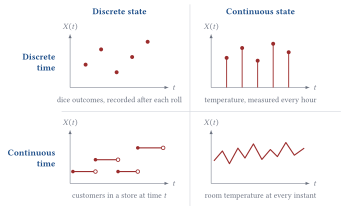
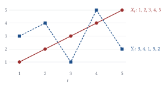
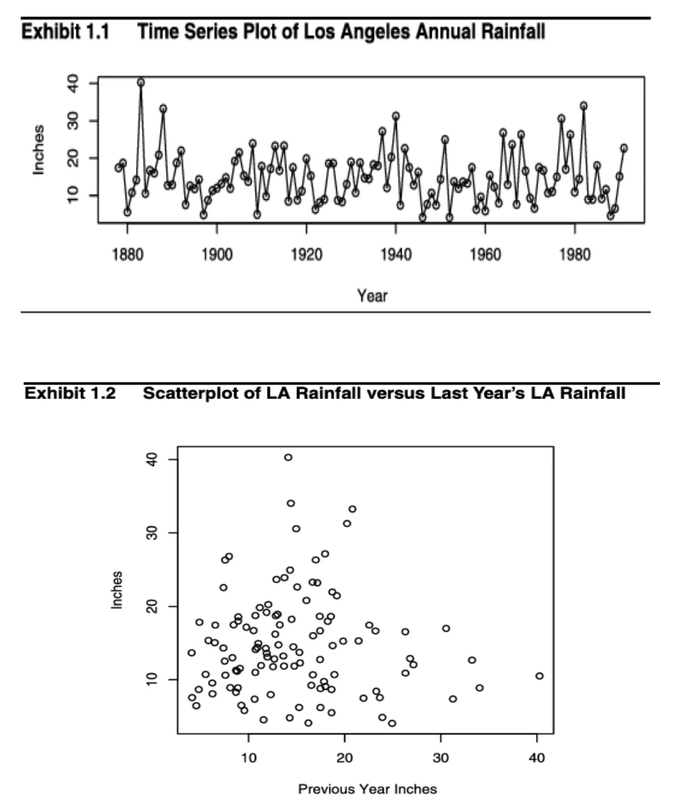
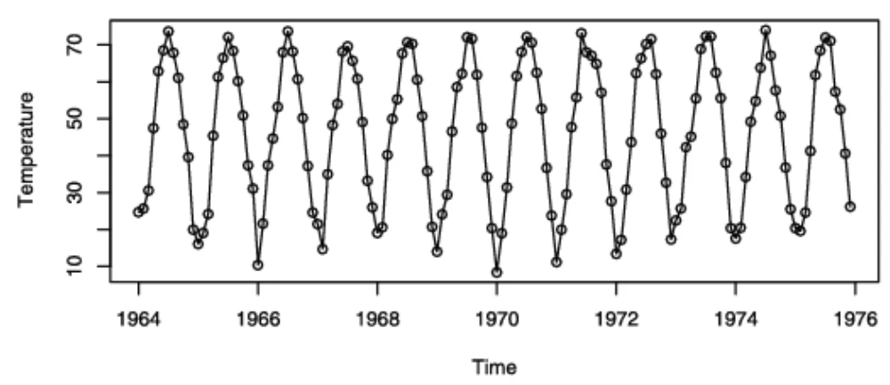
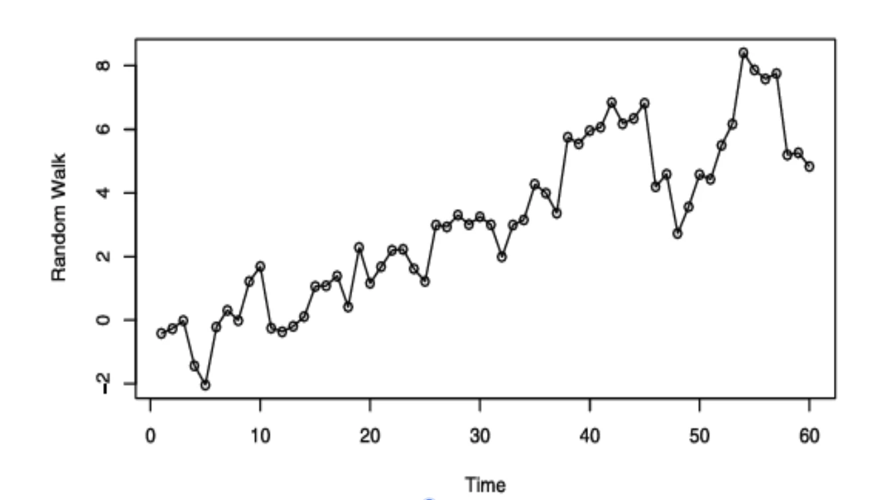
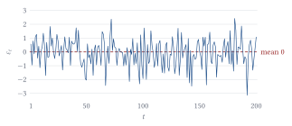

## Week 1: Introduction

### What are time series data?

Time series data are collected **sequentially over time**. Meteorological data taken daily or hourly are a typical example: temperatures, precipitation levels, and so on.

The major goals:

1. To model the *stochastic phenomenon* that produces these data. A stochastic phenomenon is a real-world process whose outcomes involve randomness.
2. To predict or forecast the future values of the time series.

<Callout type="note" title="Forecasting or prediction?">
**Forecasting** is a data-driven process that estimates future events from historical time series data. **Prediction** is broader: a general estimate of unknown outcomes, which may or may not rely on time or on past data.
</Callout>

<Callout type="tip" title="Key aspect">
Observations measured across time are typically *dependent* random variables, not independent ones.
</Callout>

### Stochastic processes

<Callout type="definition" title="Stochastic process">
A stochastic process is a collection of random variables indexed by time (or by another index):

$$
\left\{ Y_t \right\}_{t=-\infty}^{\infty}
$$
</Callout>

For example, consider the daily temperature in Ankara:

- $Y_1$, the temperature on Monday, is a random variable.
- $Y_2$, the temperature on Tuesday, is a random variable.
- $Y_3$, the temperature on Wednesday, is a random variable.

Together, these random variables form a stochastic process. The theory of stochastic processes gives us a formal way to look at time series data.

We write the process as $Y(\omega, t)$, a function of two arguments:

- $\omega$ is the **outcome**. It belongs to the sample space $\Omega$: one possible outcome out of all of them.
- $t$ is **time**. It belongs to the index set (Monday, Tuesday, Wednesday, ...).

Here is a small version with three possible weather scenarios. Each column is one way the week could turn out.

| Time      | Scenario $\omega_1$ | Scenario $\omega_2$ | Scenario $\omega_3$ |
| :-------- | :-----------------: | :-----------------: | :-----------------: |
| Monday    | 20°                 | 18°                 | 22°                 |
| Tuesday   | 22°                 | 19°                 | 23°                 |
| Wednesday | 21°                 | 17°                 | 25°                 |

#### Fixed $t$: a random variable

Suppose we fix $t = \text{Tuesday}$. Then $Y(\omega, \text{Tuesday})$ collects all possible temperatures on Tuesday: 22, 19 and 23. ==This is a random variable==, because its value depends on which scenario $\omega$ occurs.

Even if there were only one outcome, $\omega_1$, it would still be a random variable, with $P(Y_{\text{Tuesday}} = 22) = 1$. A random variable like this is called **degenerate**.

#### Fixed $\omega$: a realization

Suppose we fix $\omega = \omega_1$. Then $Y(\omega_1, t)$ follows one particular scenario through time: $20 \to 22 \to 21$. This is called a **realization**, a **sample function** or a **sample path**. It represents one possible trajectory of the stochastic process (*olası yörünge*).

|                     | Fixed $t$                       | Fixed $\omega$                         |
| :------------------ | :------------------------------ | :------------------------------------- |
| What changes?       | $\omega$ (the outcome)          | $t$ (time)                             |
| What do we obtain?  | A random variable               | A sample path (realization)            |
| What do we examine? | The possible values at one time | The values across time in one scenario |

$$
\begin{aligned}
\text{fixed time} &\;\Rightarrow\; \text{random variable} \\
\text{fixed outcome} &\;\Rightarrow\; \text{sample path (realization)}
\end{aligned}
$$

### Continuous time vs. discrete time

In practice we cannot measure a physical quantity at every possible instant. However, that does not mean the underlying process cannot be modeled in continuous time.

The distinction is about **which time points belong to the index set $T$**, not how frequently we can physically measure something.

#### Discrete time

A **discrete-time stochastic process** is defined at separate time points:

$$
T = \{0, 1, 2, \dots\}
$$

For example, suppose we measure the temperature every hour.

| Time  | Temperature |
| :---- | :---------: |
| 12:00 | 22°         |
| 13:00 | 23°         |
| 14:00 | 24°         |

Our observed sequence is $X_0 = 22$, $X_1 = 23$, $X_2 = 24$. We have values only at the specified times.

<Callout type="tip" title="Keep in mind">
We do not necessarily know the temperature at 12:30 from these observations.
</Callout>

#### Continuous time

A **continuous-time stochastic process** is indexed by every real-valued time point in an interval:

$$
T = [0, \infty)
$$

For example $X(0), X(0.1), X(0.01), X(\sqrt{2}), X(\pi)$, and so on. Mathematically, the process has a random variable associated with every real-valued time point. ==We don't need to measure every one of them.==

#### How can a continuous-time process exist if we cannot measure it continuously?

Imagine you have a thermometer that works every 10 minutes. At 12:00 it reads 22, and at 12:10 it reads 23. Did your room have a temperature at 12:05? Yes. What about at 12:05:30.00001? Also yes.

Therefore we can describe the room temperature with a continuous-time model $\{X(t) : t \geq 0\}$, even though our thermometer gives us only discrete measurements $X(0), X(10), X(20), \dots$ Here time is measured in minutes.

<Callout type="tip" title="Continuous time is not continuous observation">
A continuous-time process does not require continuous observations.
</Callout>

### Parameter space and state space

- The **parameter space** answers: when can the process be evaluated?
- The **state space** answers: what values can the process take?

These are independent concepts, so each can be discrete or continuous.

For example, let $N(t)$ be the number of customers at time $t$. Then $N(t) \in \{0, 1, \dots\}$, so the state space is discrete. But $t$ can be anything, such as 1.2341, so the time parameter is continuous.

### Four important properties

1. A time series is a realization, or sample function, from a certain stochastic process.
2. Observations are dependent. Therefore *we do not have a random sample*. The exception is white noise.
3. We assume that observations are equally spaced in time.
4. Closer observations might have stronger dependency.

### Time order changes the analysis

Both series have the same values, the same mean, the same variance and the same histogram, but different temporal patterns. Time plots and lagged relationships preserve information that a histogram loses. The **lag** is the distance between observations in time.

<Callout type="tip" title="Order matters">
Same observations plus a different order give a different temporal structure.
</Callout>

### Example: rainfall in Los Angeles

Can we predict this year's rainfall using last year's rainfall? We have annual rainfall observations from Los Angeles over more than 100 years. Let $X_t$ be the total rainfall in year $t$. We want to investigate whether $X_t$ depends on $X_{t-1}$.

**First plot.** Annual rainfall fluctuates considerably. Some years are exceptionally wet; others are very dry. There is no obvious long-term upward or downward trend, and we cannot easily identify a repeating pattern. Conclusion: the time plot shows substantial variability, but it does not immediately tell us whether consecutive years are correlated.

**Second plot.** The points form a scattered cloud without a clear upward or downward relationship, so $\operatorname{Corr}(X_t, X_{t-1}) \approx 0$.

From a modeling or forecasting point of view, this is not a very interesting time series.

### Seasonality

This time series displays a very regular pattern called ==seasonality==. In monthly values, seasonality occurs when observations 12 months apart are related in some manner or another.

### Steps in time series analysis

#### 1. Model identification

Before building a model we examine the data. The goal is to understand the behaviour of the time series and to determine which models might be suitable. We check four things:

1. **Trend**: a long-term increase or decrease. *The population increases over 20 years.*
2. **Seasonality**: a pattern repeating at fixed intervals. *Electricity demand increases every summer.*
3. **Sharp changes**: sudden changes in the process's behaviour. *The population suddenly drops after an epidemic.*
4. **Outliers**: unusually extreme values. *The population unexpectedly reaches 500.*

<Callout type="tip" title="ACF and PACF">
We can also examine the ACF (autocorrelation function) and the PACF (partial autocorrelation function) to identify suitable models.
</Callout>

#### 2. Removing trend and seasonality

We remove them to get stationary residuals. Many classical time series models, such as ARMA, assume that the process is **stationary**.

Weak stationarity means:

1. The mean does not change over time: $E[X_t] = \mu$.
2. The variance does not change over time: $\operatorname{Var}(X_t) = \sigma^2$.
3. ==The autocovariance depends only on the time difference (lag)==, not on the specific time: $\operatorname{Cov}(X_t, X_{t-k}) = \gamma(k)$.

For example, we might decompose our time series as

$$
X_t = T_t + S_t + R_t
$$

where $T_t$ is the trend component, $S_t$ the seasonality and $R_t$ the remainder component. Then

$$
R_t = X_t - T_t - S_t
$$

and we can analyze the remainder using a stationary time series model, if that is appropriate.

<Callout type="warning" title="Important">
Removing trend and seasonality does not automatically guarantee stationarity. Also, the remainder may still contain autocorrelation that we need to model.
</Callout>

#### 3. Estimation

Once we select a model, we need to estimate its parameters. Suppose we choose an AR(1) model

$$
X_t = c + \phi X_{t-1} + \varepsilon_t
$$

where the unknown parameters are $c$, the intercept, $\phi$, the **autoregressive coefficient**, and $\sigma^2$, the error variance.

- **Method of moments estimation** matches theoretical moments with sample moments. For a stationary AR(1), $\rho(1) = \phi$, so the method of moments estimate is $\hat{\phi} = \hat{\rho}(1)$.
- **Maximum likelihood estimation** finds the values that maximize the likelihood: $\hat{\theta}_{\text{MLE}} = \arg\max_{\theta} L(\theta)$.

#### 4. Diagnostic checking

After estimating the model, we analyze its **residuals**:

$$
\hat{\varepsilon}_t = X_t - \hat{X}_{t \mid t-1}
$$

The goal is to check whether our fitted model adequately explains the time series:

- Normality of the error terms.
- Independence of the error terms: the errors do not contain ==temporal dependence== (dependence related to time).
- Homoscedasticity: a constant error variance.

#### 5. Forecasting

Once we have a satisfactory model, we can forecast future values.

**Exponential smoothing** generates forecasts using weighted averages of past observations, giving more weight to recent observations. The simplest one is

$$
L_t = \alpha X_t + (1 - \alpha) L_{t-1}
$$

where $L_t$ is the smoothed level, $\alpha$ the smoothing parameter and $X_t$ the current observation.

**Minimum MSE forecasting** finds the forecast that minimizes the expected squared prediction error:

$$
\text{MSE} = E\left[ \left( X_{t+h} - \hat{X}_{t+h} \right)^2 \right]
$$

Under squared error loss the optimal forecast is the conditional expectation

$$
\hat{X}_{t+h \mid t} = E\left[ X_{t+h} \mid \mathcal{F}_t \right]
$$

where $\mathcal{F}_t$ is the information available at time $t$.

### Moments

The **mean function** of a stochastic process $\{Y_t\}$ gives the expected value of the process at time $t$:

$$
\mu_t = E[Y_t] \quad \text{for all } t
$$

$\mu_t$ could vary across time.

The **autocovariance function** is

$$
\gamma_{t,s} = \operatorname{cov}(Y_t, Y_s) \quad \text{for } t, s
$$

where

$$
\operatorname{cov}(Y_t, Y_s) = E\left[ (Y_t - \mu_t)(Y_s - \mu_s) \right] = E[Y_t Y_s] - \mu_t \mu_s
$$

The **autocorrelation function** is

$$
\rho_{t,s} = \operatorname{corr}(Y_t, Y_s) \quad \text{for } t, s
$$

where

$$
\operatorname{corr}(Y_t, Y_s) = \frac{\operatorname{cov}(Y_t, Y_s)}{\sqrt{\operatorname{var}(Y_t)\operatorname{var}(Y_s)}}
$$

#### Autocovariance vs. autocorrelation

Both measure ==linear relationships== between $Y_t$ and $Y_s$.

- The autocovariance $\gamma_{t,s}$ measures how two observations vary together.
- The autocorrelation $\rho_{t,s}$ is the standardized autocovariance, always between $-1$ and $1$.

#### Positive vs. negative autocovariance

- Positive autocovariance ($\gamma_{t,s} > 0$): if $Y_t$ is above (below) its mean, $Y_s$ tends to be above (below) its mean.

#### Autocovariance at the same time

$$
\gamma_{t,t} = \operatorname{var}(Y_t) \quad \text{because} \quad \operatorname{cov}(Y_t, Y_t) = \operatorname{var}(Y_t)
$$

<Callout type="note" title="Recall">
$\operatorname{Var}(Y_t) = E[Y_t^2] - \left(E[Y_t]\right)^2$
</Callout>

#### Two formulas

**Formula 1.**

$$
\operatorname{cov}\left[ \sum_{i=1}^{m} c_i Y_{t_i}, \sum_{j=1}^{n} d_j Y_{s_j} \right] = \sum_{i=1}^{m} \sum_{j=1}^{n} c_i d_j \operatorname{cov}(Y_{t_i}, Y_{s_j})
$$

It is the same idea as $\operatorname{Cov}(aX + bY, Z) = a\operatorname{Cov}(X, Z) + b\operatorname{Cov}(Y, Z)$.

**Formula 2.**

$$
\operatorname{var}\left[ \sum_{i=1}^{n} c_i Y_{t_i} \right] = \sum_{i=1}^{n} c_i^2 \operatorname{var}(Y_{t_i}) + 2 \sum_{i=2}^{n} \sum_{j=1}^{i-1} c_i c_j \operatorname{cov}(Y_{t_i}, Y_{t_j})
$$

It is the same idea as

$$
\begin{aligned}
\operatorname{var}(X + Y + Z) &= \operatorname{var}(X) + \operatorname{var}(Y) + \operatorname{var}(Z) \\
&\quad + 2\operatorname{cov}(X, Y) + 2\operatorname{cov}(X, Z) + 2\operatorname{cov}(Y, Z)
\end{aligned}
$$

### A simple time series process: the random walk

<Callout type="definition" title="Random walk">
A random walk is a process where each value equals the previous value plus a random change:

$$
Y_t = Y_{t-1} + e_t
$$

where $Y_t$ is the current step, $Y_{t-1}$ the previous step and $e_t$ the random step.
</Callout>

The random steps $e_t$ are i.i.d., with $E[e_t] = 0$ and $\operatorname{Var}(e_t) = \sigma_e^2$.

| Time | Random step $e_t$ | Position $Y_t$ |
| :--: | :---------------: | :------------: |
| 1    | +2                | 2              |
| 2    | −1                | 1              |
| 3    | +3                | 4              |
| 4    | −2                | 2              |

$Y_1 = 2$, $Y_2 = 2 - 1 = 1$, $Y_3 = 1 + 3 = 4$: each position depends on the previous position.

<Callout type="tip" title="Independent steps, dependent positions">
Although the random steps $e_t$ are independent, the positions $Y_t$ are dependent.
</Callout>

This is because

$$
Y_t = e_1 + e_2 + e_3 + \dots + e_t
$$

so each position contains all the previous random steps. This produces

$$
E[Y_t] = 0 \quad \text{and} \quad \operatorname{Var}(Y_t) = t\sigma_e^2
$$

<Callout type="tip" title="Growing variance">
The variance of a random walk increases with time.
</Callout>

#### A random walk example

This example shows one realization of a random walk. Notice that the graph generally goes upward, from about 0 to 5. Does this mean the process has an upward trend? Not necessarily. The random steps have zero mean, $E[e_t] = 0$, so $E[Y_t] = 0$. The upward movement is simply what happened ==in this particular realization==.

Why is a random walk interesting? Although the individual steps are independent, the positions are dependent. Since $Y_t = e_1 + \dots + e_t$, consequently $\operatorname{var}(Y_t) = t\sigma_e^2$: the variance increases over time, and ==the position becomes increasingly uncertain==.

Below, each line is one realization of a simple random walk, which moves up or down by 1 at every step with equal chance. Move the time to see how the spread of the positions grows.

<RandomWalk paths="8" steps="60" seed="497" caption="Eight sample paths of a simple random walk. The dashed line fixes the time t, and the dots on it are the values of the random variable at that time. The highlighted line fixes the outcome ω: one realization." />

#### Autocovariance of a random walk

Write $Y_t = e_1 + e_2 + \dots + e_t$, where the $e_t$ are independent, and calculate $\operatorname{Cov}(Y_t, Y_s)$. For example, take $t = 2$ and $s = 4$:

$$
Y_2 = e_1 + e_2, \qquad Y_4 = e_1 + e_2 + e_3 + e_4
$$

therefore

$$
\operatorname{Cov}(Y_2, Y_4) = \operatorname{Cov}(e_1 + e_2,\; e_1 + e_2 + e_3 + e_4)
$$

Here $\operatorname{cov}(e_1, e_1) = \sigma_e^2$ and $\operatorname{cov}(e_2, e_2) = \sigma_e^2$, and all the others are 0 by independence. So $\operatorname{Cov}(Y_2, Y_4) = 2\sigma_e^2$, and in general

$$
\operatorname{Cov}(Y_t, Y_s) = \min(t, s)\, \sigma_e^2
$$

#### Autocorrelation of a random walk

For $t < s$,

$$
\rho_{t,s} = \operatorname{corr}(Y_t, Y_s) = \frac{\operatorname{cov}(Y_t, Y_s)}{\sqrt{\operatorname{var}(Y_t)\operatorname{var}(Y_s)}} = \frac{t\sigma_e^2}{\sqrt{t\sigma_e^2 \cdot s\sigma_e^2}} = \sqrt{\frac{t}{s}}
$$

| Comparison         | Autocorrelation                 |
| :----------------- | :------------------------------ |
| $Y_1$, $Y_2$       | $\sqrt{1/2} = 0.707$            |
| $Y_{24}$, $Y_{25}$ | $\sqrt{24/25} = 0.980$          |
| $Y_1$, $Y_{25}$    | $\sqrt{1/25} = 0.200$           |

Nearby values tend to be more strongly correlated, and later neighboring values are more strongly correlated still. At later times the random walk has accumulated many random steps, and consecutive positions share almost all of them.

Remember that for a weakly stationary process, the autocovariance depends only on the lag:

$$
\gamma_{t,s} = \gamma(|t - s|)
$$

But for a random walk,

$$
\gamma(t, s) = \min(t, s)\, \sigma_e^2
$$

It depends on the actual time points, ==not just their difference==. For example $\operatorname{Cov}(Y_1, Y_2) = \sigma_e^2$ but $\operatorname{Cov}(Y_{24}, Y_{25}) = 24\sigma_e^2$. Both pairs have lag 1, but their autocovariances differ.

<Callout type="note" title="Why auto">
We say *auto*covariance and *auto*correlation, rather than only covariance and correlation, because we are measuring the relationship between the same variable at different times, rather than between two different variables.
</Callout>

### A simple moving average process

<Callout type="definition" title="Simple moving average process">
$$
Y_t = \frac{e_t + e_{t-1}}{2}
$$

where the $e_t$ are independent random variables with $E[e_t] = 0$ and $\operatorname{var}(e_t) = \sigma_e^2$.
</Callout>

Unlike a random walk, which accumulates all previous shocks, this process uses only the current and the previous shock.

$$
Y_3 = \frac{e_3 + e_2}{2} \quad \text{and} \quad Y_4 = \frac{e_4 + e_3}{2}
$$

Both include $e_3$. This creates dependence.

#### Mean and variance

$$
E[Y_t] = \frac{E[e_t] + E[e_{t-1}]}{2} = 0
$$

Since the shocks are independent,

$$
\operatorname{Var}(Y_t) = \frac{1}{4}\left(\sigma_e^2 + \sigma_e^2\right) = 0.5\,\sigma_e^2
$$

#### Autocovariance

At lag 1, the only shared random variable is $e_{t-1}$:

$$
\operatorname{Cov}(Y_t, Y_{t-1}) = \operatorname{cov}\left( \frac{e_t + e_{t-1}}{2}, \frac{e_{t-1} + e_{t-2}}{2} \right) \quad\Rightarrow\quad \gamma(1) = \frac{1}{4}\sigma_e^2
$$

At lag 2 there are no overlapping shocks:

$$
\operatorname{Cov}(Y_t, Y_{t-2}) = \operatorname{cov}\left( \frac{e_t + e_{t-1}}{2}, \frac{e_{t-2} + e_{t-3}}{2} \right)
$$

Since all the shocks are independent, $\gamma(2) = 0$. Generally, $\gamma(k) = 0$ if $|k| > 1$.

#### Autocorrelation

$$
\rho(k) = \frac{\gamma(k)}{\sigma_Y^2} = \frac{\gamma(k)}{\gamma(0)}
$$

where $\gamma(0)$ is the autocovariance at lag 0. With $\gamma(0) = \frac{1}{2}\sigma_e^2$ and $\gamma(1) = \frac{1}{4}\sigma_e^2$,

$$
\rho(1) = \frac{\sigma_e^2 / 4}{\sigma_e^2 / 2} = 0.5
\qquad\Rightarrow\qquad
\rho(k) = \begin{cases} 1 & k = 0 \\ 0.5 & |k| = 1 \\ 0 & |k| > 1 \end{cases}
$$

This means consecutive observations are positively correlated, but observations separated by two or more periods are uncorrelated.

#### Why this is related to stationarity

Weak stationarity requires a constant mean, a constant variance, and an autocovariance that depends only on the lag. For this MA(1) process,

$$
E[Y_t] = 0, \qquad \operatorname{var}(Y_t) = 0.5\,\sigma_e^2, \qquad \operatorname{cov}(Y_t, Y_{t-1}) = 0.25\,\sigma_e^2
$$

These quantities do not depend on the particular time $t$. Therefore the MA(1) process is weakly stationary.

<Callout type="tip" title="The most important idea">
An MA(1) process has autocorrelation only at lag 1. Its autocorrelation becomes exactly 0 for all larger lags. This property is called the **ACF cutoff** of an MA(1) process.
</Callout>

### Stationarity

A stochastic process is **stationary** when its statistical behaviour does not change over time. There are two types.

<Callout type="definition" title="Strict stationarity">
A process is strictly stationary if shifting time does not change any of its joint probability distributions. For example,

$$
(Y_1, Y_3, Y_4) \overset{d}{=} (Y_6, Y_8, Y_9)
$$

with all the time indices shifted by 5.
</Callout>

This means the two vectors have the same joint distribution, *not* that their observed values must be equal.

<Callout type="definition" title="Weak stationarity">
A process is weakly stationary if three conditions hold:

- $E[Y_t] = \mu$, a constant mean;
- $\operatorname{var}(Y_t) = \sigma^2$, a constant variance;
- $\operatorname{cov}(Y_t, Y_{t-k}) = \gamma(k)$, which depends only on the lag.
</Callout>

For example, $\operatorname{cov}(Y_2, Y_3)$ and $\operatorname{cov}(Y_{20}, Y_{21})$ are equal: both pairs have lag 1.

<Callout type="tip" title="Important difference">
Strict stationarity concerns entire distributions; weak stationarity concerns only the first two moments. Strict stationarity implies weak stationarity when ==finite second moments exist==, but the reverse is not generally true. For Gaussian processes, the two are equivalent.
</Callout>

#### Why does the autocovariance depend only on the lag?

For a stationary process,

$$
\operatorname{Cov}(Y_t, Y_s) = \operatorname{Cov}(Y_{t-k}, Y_{s-k})
$$

Shifting both time indices by the same amount does not change their covariance. Therefore we can write

$$
\gamma(k) = \operatorname{Cov}(Y_t, Y_{t-k})
$$

The actual time $t$ is irrelevant; only the separation $k$ matters. This is why stationary processes have autocorrelation functions of the form

$$
\rho(k) = \frac{\gamma(k)}{\gamma(0)}
$$

### White noise

White noise is the simplest example of a weakly stationary process.

<Callout type="definition" title="White noise">
Let $\varepsilon_t \sim \text{WN}(0, \sigma^2)$. This means

$$
E[\varepsilon_t] = 0, \qquad \operatorname{var}(\varepsilon_t) = \sigma^2, \qquad \operatorname{cov}(\varepsilon_t, \varepsilon_{t-k}) = 0 \quad (k \neq 0)
$$
</Callout>

The values fluctuate around zero without a systematic or visible temporal trend.

From the lecture slides:

- The white noise process is a simple example of a stationary process.
- White noise is simply a sequence of i.i.d. random variables $\{e_t\}$.
- White noise is strictly stationary, since

$$
\begin{aligned}
P[e_{t_1} \leq x_1, \dots, e_{t_n} \leq x_n] &= P[e_{t_1} \leq x_1] \cdots P[e_{t_n} \leq x_n] \\
&= P[e_{t_1 - k} \leq x_1] \cdots P[e_{t_n - k} \leq x_n] \\
&= P[e_{t_1 - k} \leq x_1, \dots, e_{t_n - k} \leq x_n]
\end{aligned}
$$

- Clearly $\mu_t = E(e_t)$ is constant, and $\gamma_k = \operatorname{var}(e_t) = \sigma_e^2$ for $k = 0$ and zero for any $k \neq 0$.

Because the observations are independent and identically distributed, their joint distribution is unchanged under time shifts. Consequently i.i.d. white noise is also strictly stationary. However, general white noise does not have to be independent.

### Differencing

How can we make a random walk stationary? The random walk $Y_t = Y_{t-1} + e_t$ is nonstationary. Now subtract the previous observation from the current one:

$$
\Delta Y_t = Y_t - Y_{t-1} = (Y_{t-1} + e_t) - Y_{t-1} = e_t
\qquad\Rightarrow\qquad
\Delta Y_t = e_t
$$

| Time | $Y_t$ | $\Delta Y_t$ |
| :--: | :---: | :----------: |
| 1    | 10    |              |
| 2    | 12    | +2           |
| 3    | 11    | −1           |
| 4    | 15    | +4           |
| 5    | 13    | −2           |

If the original process is a random walk with i.i.d. zero-mean shocks, its differences are i.i.d. white noise.

<Callout type="tip" title="Differencing">
Differencing turns a nonstationary random walk into stationary white noise.
</Callout>

### Check yourself

<ConceptCheck question="Why is a random walk not weakly stationary, and how can it be made stationary?">
Its variance, $\operatorname{Var}(Y_t) = t\sigma_e^2$, grows with time, and its autocovariance $\min(t, s)\,\sigma_e^2$ depends on the actual time points rather than only on the lag. Differencing fixes both: $\Delta Y_t = Y_t - Y_{t-1} = e_t$, which is white noise and therefore stationary.
</ConceptCheck>

<ConceptCheck question="What is the autocorrelation of the simple moving average process at lags 0, 1 and 2, and what is this pattern called?">
$\rho(0) = 1$, $\rho(1) = 0.5$ and $\rho(2) = 0$; it is 0 at every lag beyond 1. Autocorrelation that stops after lag 1 is the ACF cutoff of an MA(1) process.
</ConceptCheck>
